# jolo-tsa4 — Tasks for Today: Full CRUD, Auth and Email (Laravel)

IT0049 Web System Technologies, Technical Summative Assessment 4.

TSA2 rebuilt in **Laravel 12**, on top of the TSA3 project: full CRUD for tasks, Laravel Breeze
authentication protecting every management action, soft deletion with an `is_archived` column,
and an email notification sent when a task is marked done.

**Live site:** https://jolo-tsa3n4.infinityfree.me/ (TSA3 and TSA4 on one site; the homepage links to both)
**Developer:** Jolo, BS Information Technology (Business Analytics)

## Demo login

| Email                       | Password   |
|-----------------------------|------------|
| `juan.delacruz@example.com` | `demo1234` |

The password is stored as a bcrypt hash (the `hashed` cast on the `User` model).

## Screenshots

### Welcome page with links to TSA 3 and TSA 4
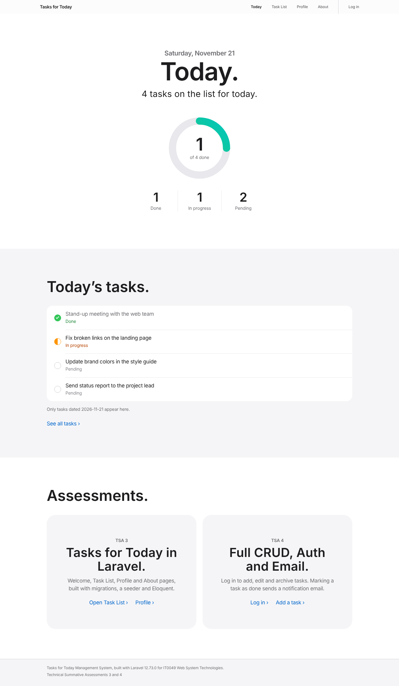

### Task List as a guest (view only)
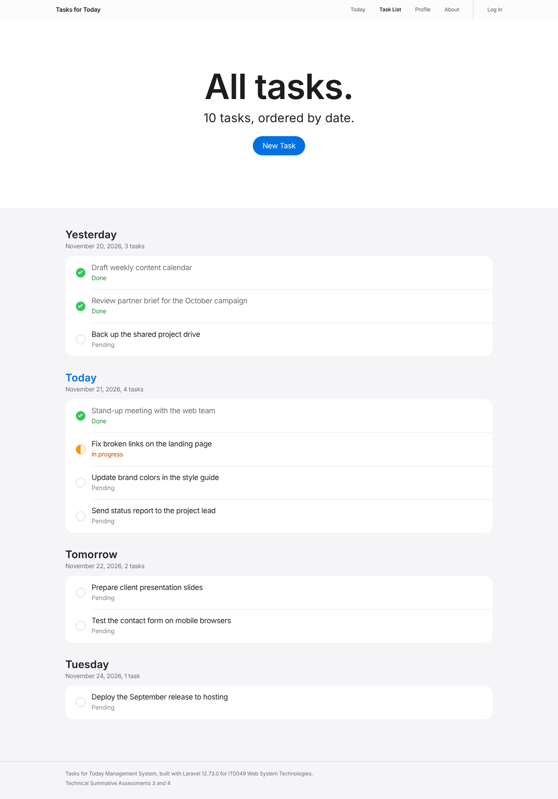

### Access control: a guest opening `/tasks/create` is sent to the login page
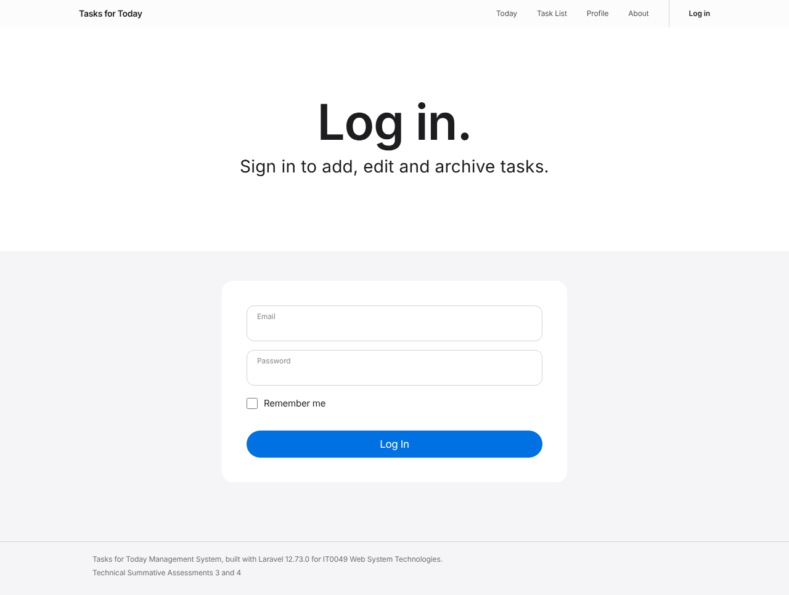

### Breeze login with a wrong password
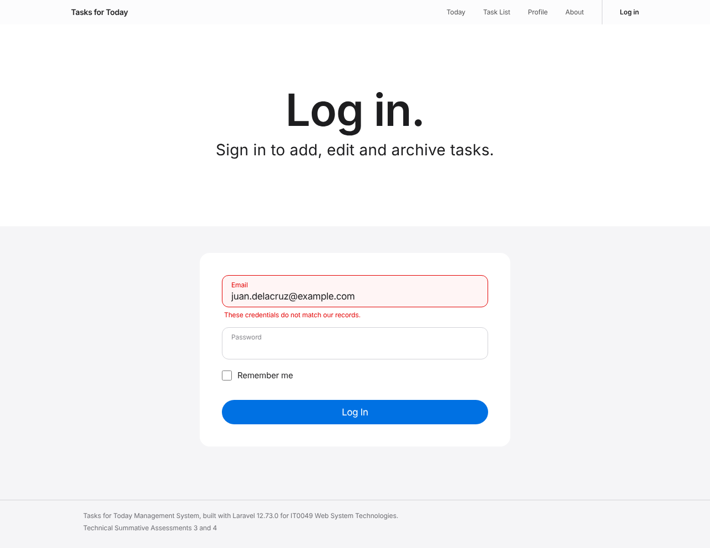

### Validation: empty title and date are rejected
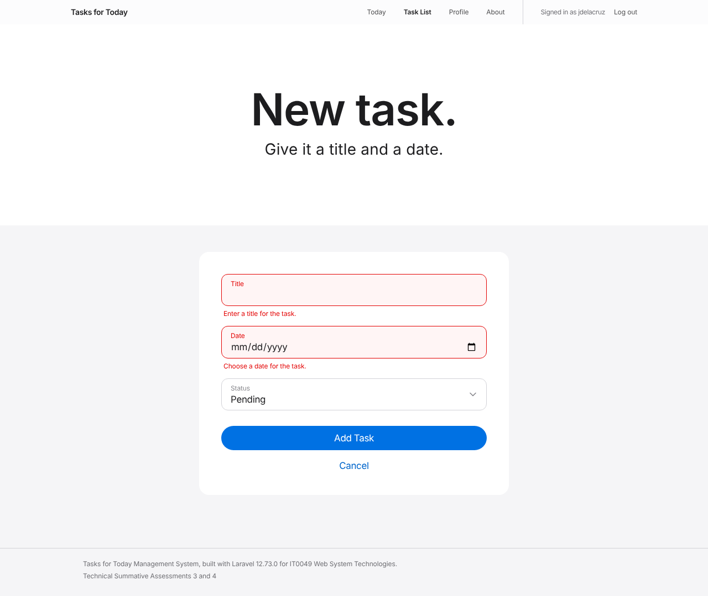

### Task added (logged in: Edit and Archive on every task)
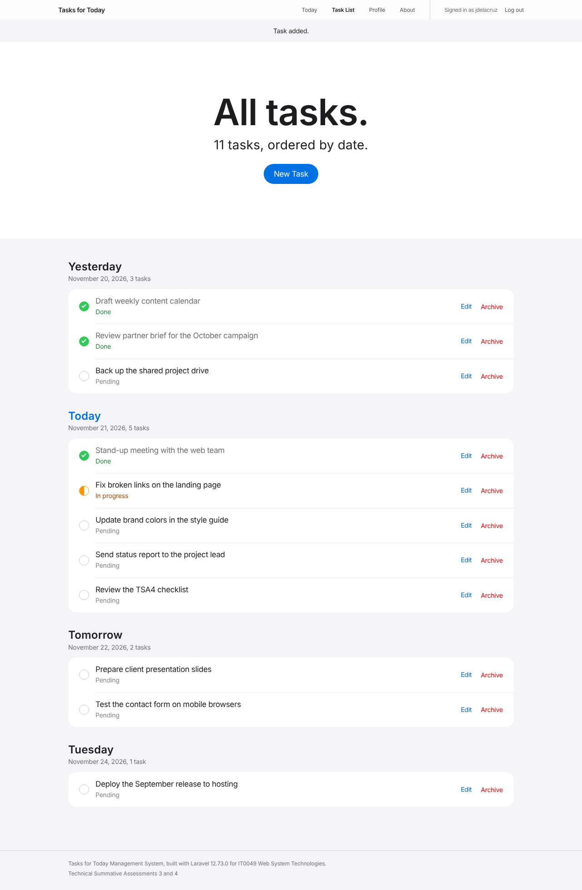

### Edit Task: changing the status to Done
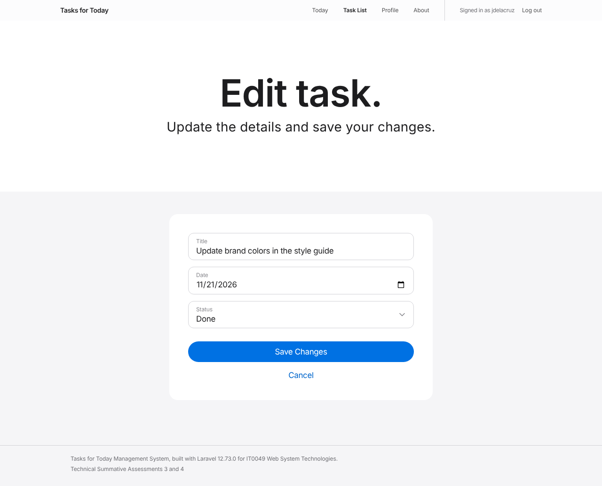

### Saved as Done: the notification email is sent


### Editing a task that is already Done: no second email
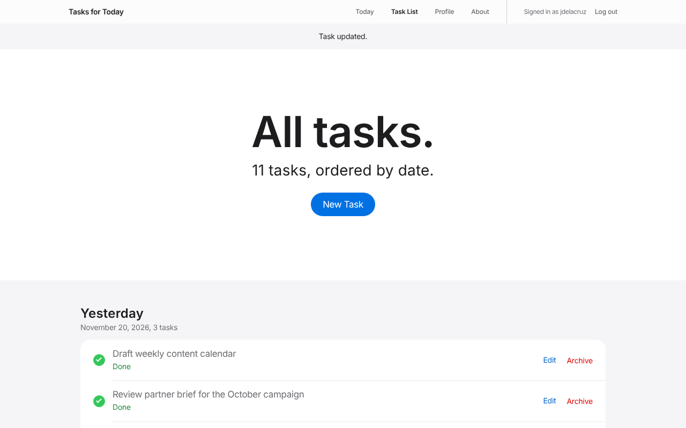

### The email, as written to `storage/logs/laravel.log`
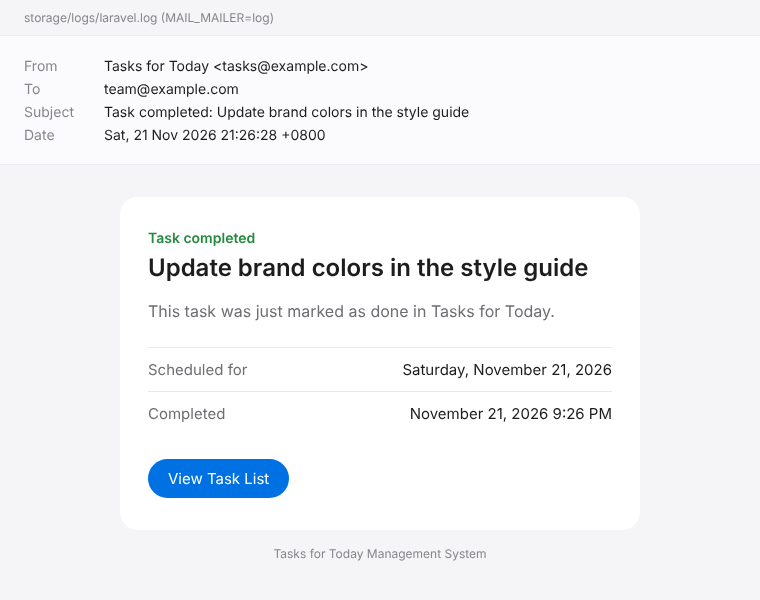

### Archive (soft delete): the task disappears from the list but stays in the database
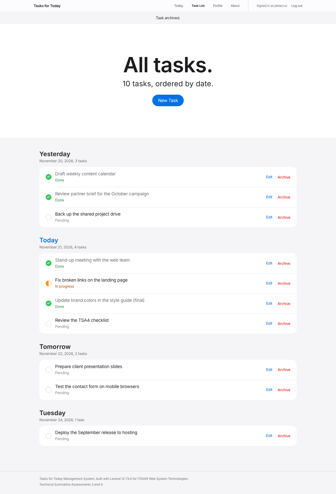

### Welcome page while logged in
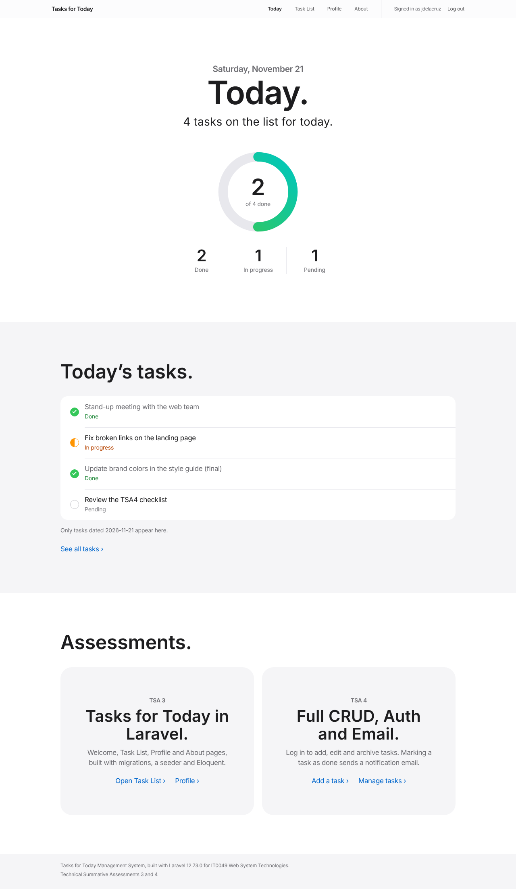

### On a phone
| Task List | New Task | Menu |
|:---:|:---:|:---:|
| 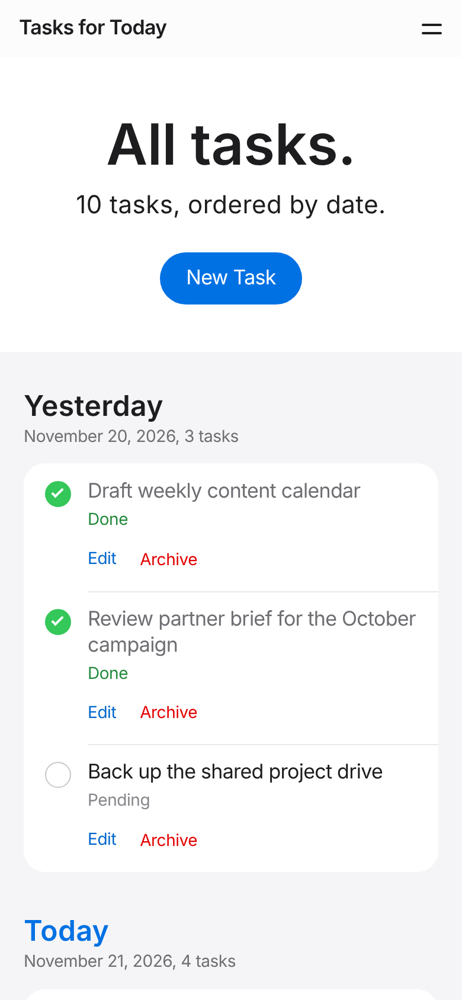 | 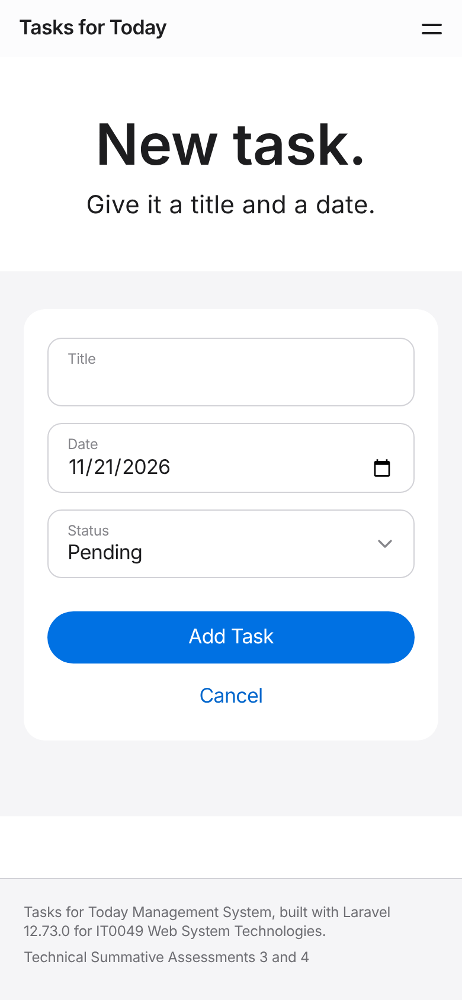 | 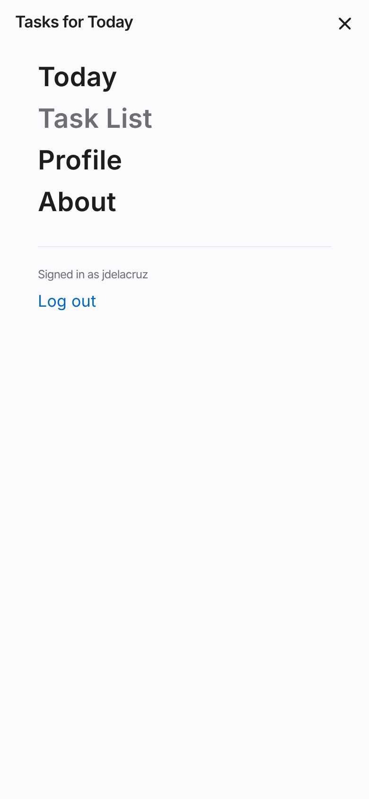 |

### Tests passing
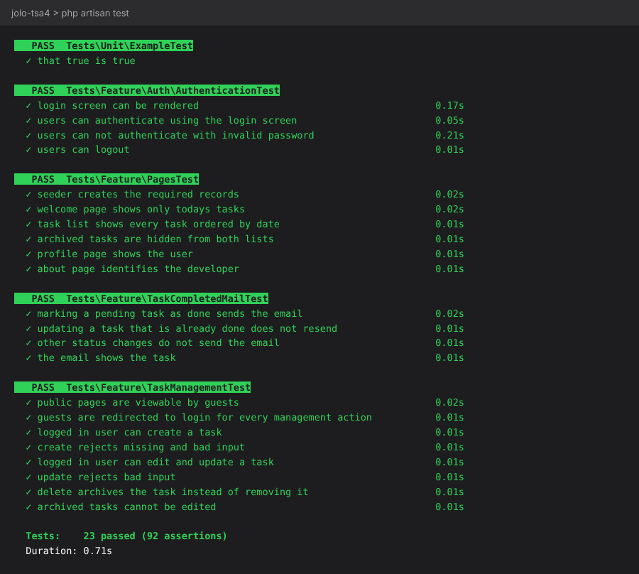

## Routes

| Method | URL                  | Route name      | Controller                               | Access    |
|--------|----------------------|-----------------|------------------------------------------|-----------|
| GET    | `/`                  | `home`          | `HomeController@index`                   | Public    |
| GET    | `/tasks`             | `tasks.index`   | `TaskController@index`                   | Public    |
| GET    | `/profile`           | `profile`       | `ProfileController@show`                 | Public    |
| GET    | `/about`             | `about`         | `PageController@about`                   | Public    |
| GET    | `/login`             | `login`         | `Auth\AuthenticatedSessionController@create`  | Guests |
| POST   | `/login`             |                 | `Auth\AuthenticatedSessionController@store`   | Guests |
| POST   | `/logout`            | `logout`        | `Auth\AuthenticatedSessionController@destroy` | Logged in |
| GET    | `/tasks/create`      | `tasks.create`  | `TaskController@create`                  | Logged in |
| POST   | `/tasks`             | `tasks.store`   | `TaskController@store`                   | Logged in |
| GET    | `/tasks/{task}/edit` | `tasks.edit`    | `TaskController@edit`                    | Logged in |
| PUT    | `/tasks/{task}`      | `tasks.update`  | `TaskController@update`                  | Logged in |
| DELETE | `/tasks/{task}`      | `tasks.destroy` | `TaskController@destroy` (archives)      | Logged in |

## Authentication (Laravel Breeze)

Breeze (Blade stack) is installed as a dev dependency and its scaffolding generated the login
controller, `LoginRequest` (with rate limiting) and `routes/auth.php`. The management routes in
`routes/web.php` sit inside `Route::middleware('auth')`, so a guest who opens or submits any of them
is redirected to `/login`, and returned to the page they wanted after logging in.

The system has a single seeded account (as in TSA1/TSA3), so Breeze's registration, password reset,
email verification and profile-editing pages were removed; `/profile` stays the public Profile page.
Breeze's Tailwind views were replaced with Blade views in the site's own style, so no Node build is needed.

CSRF protection is on for every form, and PUT/DELETE requests use `@method` form spoofing.

## Validation

`app/Http/Requests/TaskRequest.php` validates both the Create and Edit forms:

| Field       | Rules                                               |
|-------------|-----------------------------------------------------|
| `title`     | `required`, `string`, `max:150` (spaces are trimmed first) |
| `task_date` | `required`, `date_format:Y-m-d`                      |
| `status`    | `required`, one of `pending`, `in-progress`, `done`  |

Errors show under each field and the form keeps what was typed.

## Soft deletion

"Archive" (the delete action) sets `is_archived` to `true` instead of deleting the row:

```php
// app/Models/Task.php
public function scopeActive(Builder $query): void
{
    $query->where('is_archived', false);
}

// Welcome page
Task::active()->dueOn(today())->orderBy('id')->get();

// Task List page
Task::active()->ordered()->get();
```

Archived tasks disappear from both pages and cannot be edited (404), but stay in the database.

## Email notification

- **Mailable:** `app/Mail/TaskCompleted.php`, subject "Task completed: {title}"
- **View:** `resources/views/emails/task-completed.blade.php`
- **Trigger:** `TaskController@update` sends it with the `Mail` facade only when the status
  **changes** to `done`:

```php
$wasDone = $task->isDone();

$task->update($request->validated());

if (! $wasDone && $task->isDone()) {
    Mail::to(config('mail.task_notification_address'))->send(new TaskCompleted($task));
}
```

Updating a task that is already done (for example, renaming it) does not send it again.

### Mail configuration

| `.env` key                | Purpose                                                    |
|---------------------------|------------------------------------------------------------|
| `MAIL_MAILER=log`         | Writes each email into `storage/logs/laravel.log` (no real inbox needed) |
| `TASK_NOTIFICATION_EMAIL` | Who receives the "Task completed" email (`config/mail.php`) |
| `MAIL_FROM_ADDRESS`       | Sender address                                              |

To check it: mark a pending task as done, then open `storage/logs/laravel.log` and look for
`Subject: Task completed: ...` followed by the email's HTML. On InfinityFree, download that file with FileZilla.

To deliver to a test inbox instead, sign up for a free sandbox such as [Mailtrap](https://mailtrap.io)
and set `MAIL_MAILER=smtp` with its `MAIL_HOST`, `MAIL_PORT`, `MAIL_USERNAME` and `MAIL_PASSWORD`.

## Testing

```
php artisan test
```

| Test file                                   | What it checks |
|---------------------------------------------|----------------|
| `tests/Feature/TaskCompletedMailTest.php`   | Pending to done sends exactly one email to the configured address; updating a task that is already done sends nothing; other status changes send nothing; the email shows the task |
| `tests/Feature/TaskManagementTest.php`      | Public pages open for guests; every management action redirects guests to `/login` and changes nothing; logged-in create, edit, update and archive work; bad input is rejected; archived tasks cannot be edited |
| `tests/Feature/Auth/AuthenticationTest.php` | Breeze login screen, login, wrong password, logout |
| `tests/Feature/PagesTest.php`               | Seeder data, Welcome shows only today's tasks, Task List order, archived tasks hidden, Profile and About |

Manual check of the same flow on the live site:

| Action                                   | Logged out              | Logged in                         |
|------------------------------------------|-------------------------|-----------------------------------|
| View `/`, `/tasks`, `/profile`, `/about` | Page loads              | Page loads                        |
| Open `/tasks/create`                     | Redirects to `/login`   | Form loads                        |
| Edit or archive a task                   | Redirects to `/login`   | Saved / hidden, row kept          |
| Save a task with an empty title or date  | —                       | Error messages under the fields   |
| Change a pending task to Done            | —                       | "A notification email was sent." and one email in the log |
| Edit a task that is already Done         | —                       | "Task updated." and no new email  |

## Database

| Migration                                         | Change                                              |
|---------------------------------------------------|-----------------------------------------------------|
| `0001_01_01_000000_create_users_table`            | `users`: id, username (unique), full_name, email, timestamps |
| `2026_11_21_000001_create_tasks_table`            | `tasks`: id, title, status (default `pending`), task_date, timestamps |
| `2026_11_21_000002_add_is_archived_to_tasks_table`| adds `is_archived` (boolean, default false)         |
| `2026_11_21_000003_add_password_to_users_table`   | adds `password` and `remember_token` for Breeze     |

`DatabaseSeeder` creates exactly one user and 10 tasks across 4 dates relative to today.
`database/jolo_tsa4.sql` is a phpMyAdmin export of the same tables and data (it uses `CURDATE()`).

## Project structure

```
app/
├── Http/Controllers/        HomeController, TaskController, ProfileController, PageController
│   └── Auth/                AuthenticatedSessionController (Breeze)
├── Http/Requests/           TaskRequest, Auth/LoginRequest (Breeze)
├── Mail/TaskCompleted.php
└── Models/                  Task (scopes: active, dueOn, ordered), User
config/developer.php         developer details for the About page
config/mail.php              task_notification_address
database/                    migrations, seeders, factories, jolo_tsa4.sql
resources/views/
├── layouts/app.blade.php
├── partials/task-row.blade.php
├── home, tasks/index, tasks/form, profile, about, auth/login
└── emails/task-completed.blade.php
routes/web.php, routes/auth.php
tests/Feature/
docs/screenshots/            images used in this README
.htaccess                    sends requests into public/ when the project folder is the web root
```

## Run locally (XAMPP on Windows)

Requires PHP 8.2+ (XAMPP's PHP works), [Composer](https://getcomposer.org) and MySQL (XAMPP's MySQL works).

1. Start **MySQL** in the XAMPP Control Panel. In phpMyAdmin, create an empty database named `jolo_tsa4`.
2. In the project folder, run:

   ```
   composer install
   copy .env.example .env
   php artisan key:generate
   php artisan migrate --seed
   php artisan serve
   ```

3. Open http://127.0.0.1:8000 and log in with the demo account.

If `php` is not recognized, use the full path `C:\xampp\php\php.exe`.

## Deploying to free hosting (InfinityFree)

1. Run `composer install --no-dev` locally (Composer cannot run on InfinityFree).
2. Create a MySQL database in the InfinityFree control panel and import `database/jolo_tsa4.sql` with phpMyAdmin.
3. Create `.env` from `.env.example` with `APP_ENV=production`, `APP_DEBUG=false`, a generated `APP_KEY`,
   your site address in `APP_URL`, and the database host, name, user and password from the control panel.
4. Upload everything (including `vendor`, `.env` and both `.htaccess` files) into `htdocs`.

The root `.htaccess` sends every request into `public/`, so `.env`, `vendor/`, `storage/` and
`database/` cannot be opened from a browser. Sessions, cache and the queue use the file and sync
drivers, which need no extra tables.

Built with Laravel 12 so it also runs on XAMPP's PHP 8.2; Breeze 2.4, the Mail facade and Eloquent
scopes work the same way as in Laravel 13.
